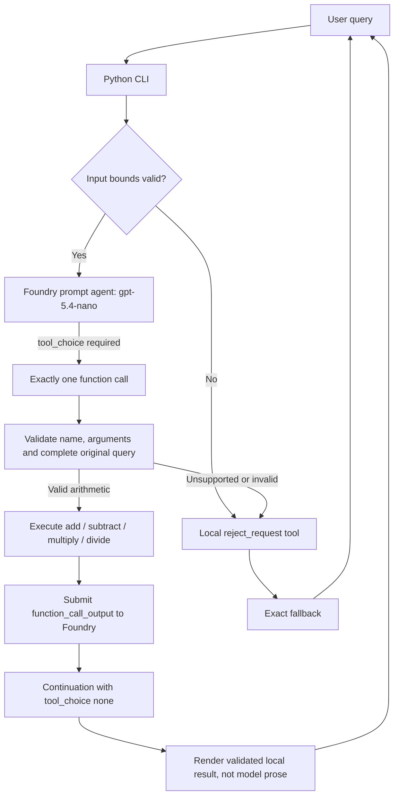

# FoundryMathAgent

A small Python agent built with Microsoft Foundry's `azure.ai.projects` SDK.
It uses the model deployment **`gpt-5.4-nano`** to select a function, executes
that function in Python, and returns its validated result. Web search is not enabled.

## Quick Start

Requires Python 3.10+, Azure CLI, a Microsoft Foundry project, and a model
deployment named `gpt-5.4-nano` supporting function calling and Responses.

```bash
python3 -m venv .venv
source .venv/bin/activate
python -m pip install -r requirements.txt
cp .env.example .env
az login
```

Set `FOUNDRY_PROJECT_ENDPOINT` in `.env`. Register the agent:

```bash
python main.py --deploy
```

Set `FOUNDRY_AGENT_VERSION` in `.env` to the version printed by that command.
Then run:

```bash
python main.py --prompt "what is 2 plus 5"
# 7
python main.py --prompt "2+5" --verbose
# 7 (tool diagnostics go to stderr)
python main.py
# Interactive terminal; exit or quit ends the session.
```

On Windows use `py -m venv .venv`, `.venv\Scripts\Activate.ps1`, and
`Copy-Item .env.example .env`. Follow [deployment.md](deployment.md) for
project creation, model deployment, permissions, verification, and cleanup.

## Supported Requests

This deliberately simple version accepts **one binary operation per request**,
with signed integer or decimal literals. Whitespace and capitalization are ignored.

| User query | Tool | Answer |
| --- | --- | --- |
| `what is 2 plus 5` or `2+5` | `add` | `7` |
| `10 minus 3` or `10-3` | `subtract` | `7` |
| `subtract 3 from 10` | `subtract(left=10, right=3)` | `7` |
| `6*7` or `multiply 6 by 7` | `multiply` | `42` |
| `9/2` or `divide 9 by 2` | `divide` | `4.5` |
| `0.1+0.2` | `add` | `0.3` |
| `hello`, `search the web`, `sqrt(9)`, `1/0` | `reject_request` | Exact fallback |

The exact fallback is:

```text
Sorry could not resolve your request
```

Optional prefixes are `what is`, `what's`, `calculate`, `compute`, `evaluate`,
and `solve`, optionally preceded by `please`. Trailing question marks and periods
are accepted. Operator phrases include `plus`, `added to`, `minus`, `less`,
`times`, `multiplied by`, and `divided by`; `x` is also accepted for multiplication.
Command forms include `add A and B`, `add A to B`, `subtract A from B`,
`multiply A by B`, and `divide A by B`. The input misspelling `substract` is
accepted in the subtraction command; the actual function is named `subtract`.

Numbers spelled as words, scientific notation, units, percentages, multi-step
expressions, algebra, word problems, contextual follow-ups, and mixed requests
such as `2+5 and tell a joke` are intentionally unsupported. Each prompt is
independent. `exit` and `quit` are CLI commands, not agent queries.

## Architecture



### Components And Responsibilities

| File | Responsibility |
| --- | --- |
| [main.py](main.py) | `.env`, Entra authentication, agent registration, remote-definition verification, CLI and client cleanup |
| [foundry_agent.py](foundry_agent.py) | Agent name, system instructions, strict function schemas, forced tool calls and tool-result submission |
| [math_tools.py](math_tools.py) | Complete-request grammar, operand verification, arithmetic function allowlist, decimal formatting and rejection tool |
| [tests/test_math_tools.py](tests/test_math_tools.py) | Offline arithmetic, syntax, validation and unsupported-input tests |
| [tests/test_foundry_agent.py](tests/test_foundry_agent.py) | Mocked Responses protocol, no-tool/search rejection and agent-definition tests |
| [.env.example](.env.example) | Configuration template with no credentials |

### What Runs In Azure

`python main.py --deploy` creates an immutable **prompt-agent version** named
`FoundryMathAgent`. Foundry stores the model deployment reference, instructions,
and the five function schemas. Foundry runs the LLM that proposes function calls.

The Python application runs locally or on infrastructure you operate. It executes
the actual functions, validates the request, and renders the answer. Registering
a function schema does **not** upload its Python implementation. This is not a
Foundry-hosted Python runtime, container deployment, or standalone HTTP API.
The Foundry portal alone does not reproduce the application's validation layer
or execute these local Python functions; use this CLI for end-to-end behavior.

### Request Lifecycle

1. The CLI loads the endpoint, deployment name, and pinned agent version. It
   authenticates with `DefaultAzureCredential` and verifies that the remote
   definition matches the local instructions and exact function allowlist.
2. The application checks input size. Empty or oversized inputs invoke the
   local rejection tool without making an LLM call.
3. The first Responses request references that exact agent version and sets
   `tool_choice="required"` and `parallel_tool_calls=False`.
4. The model proposes one function call. Missing/multiple calls, incomplete
   responses, and unexpected output tool types are rejected through `reject_request`.
5. Python parses the **whole original query**, not an arithmetic substring.
   It requires that the proposed tool and numeric operands match that query.
   The parser only validates syntax and operands; it never calculates an answer.
6. The selected arithmetic tool computes the answer. Invalid arguments, wrong
   operations, unrelated queries, and division by zero invoke `reject_request`.
7. The client submits `function_call_output`, linked by `call_id` and
   `previous_response_id`. The continuation uses `tool_choice="none"` so no
   additional arithmetic or search calls are permitted.
8. After a completed continuation, the CLI displays the locally validated tool
   result. It intentionally ignores model prose, even if the model claims a
   different answer. Protocol failures produce the exact fallback.

### Tool-Only And No-Web Guarantees

- Every handled query executes an arithmetic tool or the `reject_request` tool.
  An unsupported query does not trigger invented arithmetic just to satisfy the rule.
- `tool_choice="required"` is set on the initial request. The stored agent
   definition leaves tool choice unset so the continuation can use `"none"`.
   Foundry rejects request-level tool choices that conflict with a fixed choice
   in the agent definition. The application also checks that a function call occurred.
- There are only five function schemas. No Web Search, Bing, browser, MCP,
  code interpreter, or other external tool is registered.
- The dispatcher calls functions through a fixed dictionary, never `eval`,
  `exec`, dynamic imports, or arbitrary attribute lookup.
- A version-pinned reference and startup definition check detect accidental
  configuration drift or an added search tool before user prompts are submitted.
- These are application-level controls, not a network firewall. Azure calls still
  require network access. Do not bypass this client and expect the same guarantees.
- Model routing remains probabilistic: an incorrect or refused tool call may
  reject a valid arithmetic query. It cannot cause this client to return an
  unchecked numeric answer. Automated tests mock the model; live smoke tests
  are required to establish deployment-specific routing quality.

### Precision, Limits And Failures

Python `Decimal` executes arithmetic with 28 significant digits, including
rounding of repeating division and sufficiently large results. This is not
arbitrary-precision symbolic mathematics. The display removes unnecessary
trailing fractional zeros and normalizes zero. Prompts are limited to 500
characters, operand literals to 64 characters, and tool arguments to 1,000 characters.

The Responses client uses a 30-second request timeout and two SDK retries;
Azure's project client uses its SDK retry policy. Authentication, API, and
configuration errors are reported on stderr; runtime failures also print the
fallback and exit nonzero. Missing environment configuration exits with code 2.
No secrets or full prompts are intentionally logged. Foundry can retain response
data according to its service settings; there is no local chat-history storage.

## Configuration

| Variable | Meaning |
| --- | --- |
| `FOUNDRY_PROJECT_ENDPOINT` | Required project URL, not an Azure OpenAI inference endpoint |
| `FOUNDRY_MODEL_NAME` | Deployment name; defaults to `gpt-5.4-nano` |
| `FOUNDRY_AGENT_VERSION` | Required for chat; immutable version printed by `--deploy` |

Existing process environment variables take precedence over `.env`. Keep `.env`
private; it is Git-ignored. Local authentication normally uses your Azure CLI
login. On an Azure host, use a managed identity with appropriate Foundry roles.

## Verification And Debugging

```bash
python -m unittest discover -s tests -v
```

Tests run offline without Azure credentials, a model deployment, or usage charges.
They verify the boundary around the model, not the model's real routing behavior.
See [deployment.md](deployment.md) for live smoke tests.

In VS Code, press **F5** and select `FoundryMathAgent: Terminal Chat` after setting
up `.venv` and `.env`. This ordinary prompt-agent client uses the terminal debugger;
Foundry Toolkit Agent Inspector's hosted-agent HTTP workflow is not applicable.
You can reply with `Deploy Agent to Foundry` once the project is configured.

## References

- [Foundry function calling](https://learn.microsoft.com/azure/foundry/agents/how-to/tools/function-calling)
- [Azure AI Projects Python SDK](https://pypi.org/project/azure-ai-projects/)
- [Foundry access control](https://learn.microsoft.com/azure/foundry/concepts/rbac-foundry)